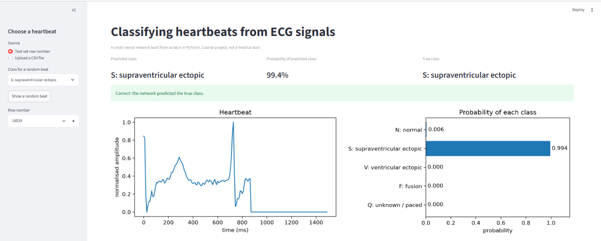
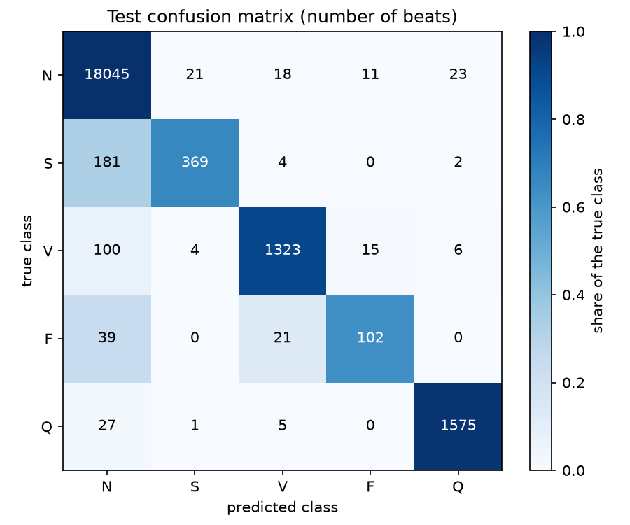
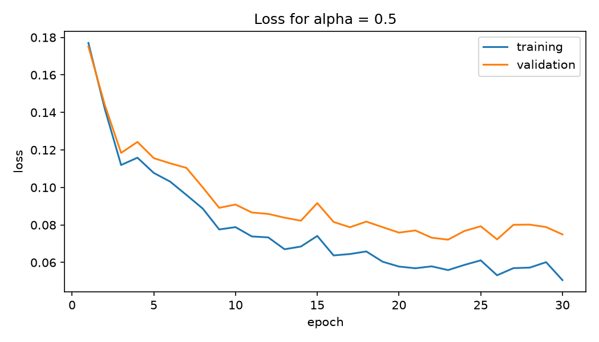

# Classifying Heartbeats from ECG Signals

A fully connected neural network, built from scratch in PyTorch, that looks at one heartbeat (187 samples of an ECG signal) and decides which of five types it is: N, S, V, F or Q.

The weight matrices, forward pass, softmax cross-entropy loss and the mini-batch gradient descent update with momentum and weight decay are all written by hand. No `nn.Linear`, `torch.optim` or `nn.CrossEntropyLoss` is used. PyTorch's automatic differentiation computes the gradients, and one of them is checked by hand.



## Team

- Member 1: Moomal Eman ([GitHub profile](https://github.com/MoomalEmaan))
- Member 2: Tayyba Bashir ([GitHub profile](https://github.com/tayyba-bashir051))

## Links

- Medium blog (Moomal Eman): (https://medium.com/@moomaleman41/my-neural-network-scored-97-8-it-still-missed-one-in-three-rare-heartbeats-41dbf95fb95c)
- Medium blog (Tayyba Bashir): (https://medium.com/@Tayyba_Bashir/building-a-heartbeat-classifier-in-pytorch-without-nn-linear-or-torch-optim-88b70ecc8792)
- LinkedIn profile : [Moomal Eman](https://www.linkedin.com/in/moomal-eman-25b632346/)
- LinkedIn profile: [Tayyba Bashir](https://www.linkedin.com/in/tayyba-bashir-77983a332/)


## Results

| Measure | Value |
|---|---|
| Test accuracy | 97.82% |
| Balanced accuracy | 83.65% |
| Always-"N" accuracy | 82.76% |

| Class | N | S | V | F | Q |
|---|---|---|---|---|---|
| Per-class accuracy | 99.60% | 66.37% | 91.37% | 62.96% | 97.95% |

Overall accuracy is high, but the network recognises only about two in three S and F beats. Because about 83% of the beats are normal, accuracy alone hides how the network does on the rare classes. The full answers are in [results/analysis.md](results/analysis.md).

The confusion matrix shows where the mistakes go. Most wrongly classified S and F beats are predicted as N:



Training and validation loss for the chosen learning rate (0.5). The parameters were saved from epoch 23, where validation loss was lowest:



## Dataset

[ECG Heartbeat Categorization Dataset](https://www.kaggle.com/datasets/shayanfazeli/heartbeat) from Kaggle, based on the MIT-BIH Arrhythmia Database. Only `mitbih_train.csv` and `mitbih_test.csv` are used.

The CSV files are too large for GitHub, so they are not in this repository. Download them from Kaggle, unzip them and put both files in `data/`.

## Setup

Python 3 is needed. Install the libraries with:

```
pip install -r requirements.txt
```

`requirements.txt` lists the exact versions the project was tested with.

The code runs on a normal CPU. No GPU is needed.

## How to run

Run every command from the project folder, in this order:

| Step | Command | What it does |
|---|---|---|
| 1 | `python src/load_data.py` | Checks that the two CSV files load |
| 2 | `python src/plot_beats.py` | Plots one example beat per class |
| 3 | `python src/prepare.py` | Task 1: checks the data, splits it and saves Table 1 |
| 4 | `python src/model.py` | Task 2: shows the parameter shapes and total (32,645) |
| 5 | `python src/grad_check.py` | Task 3.2: compares the hand-computed gradient with PyTorch's |
| 6 | `python src/train.py` | Task 4: trains for each learning rate, saves the best model, curves and Tables 2 and 3 |
| 7 | `python src/test_model.py` | Task 5: tests the saved model once and saves Table 4 and the confusion matrix |
| 8 | `streamlit run app/app.py` | Task 7: opens the front end in the browser |

Step 5 must run before step 6, because Table 2 uses the gradient check result. Training all three learning rates takes about 3 minutes on a laptop CPU (Intel Core i5-6300U).

`results/best_model.pt` is included, so steps 7 and 8 work without training again.

## Front end

The app lets you:

- type a test-set row number, or show a random beat of a chosen class
- upload a CSV file with one row of 187 values
- see the heartbeat plotted, the predicted class and the probability of all five classes
- see whether the prediction was correct, when the true class is known

To try the upload option, use `app/sample_beat.csv`. It holds one V (ventricular ectopic) beat from the test set, row 18674, without its label.

## Repository layout

```
data/                 the two CSV files (not committed)
src/
  load_data.py        the given loader
  plot_beats.py       the given plotting helper
  prepare.py          Task 1
  model.py            ECGNet and cross_entropy
  grad_check.py       Task 3.2
  train.py            Task 4
  metrics.py          accuracy, confusion_matrix and per_class_accuracy
  test_model.py       Task 5
app/
  app.py              Task 7 front end
  sample_beat.csv     one heartbeat for testing the upload option
results/
  figures/            all figures, including the app screenshot
  tables/             Tables 1 to 4, the confusion matrix and the gradient check
  analysis.md         Task 6 answers
  beat_description.md how the five beat types look different
  best_model.pt       saved parameters from the best epoch
requirements.txt      the libraries and versions used
README.md
```
